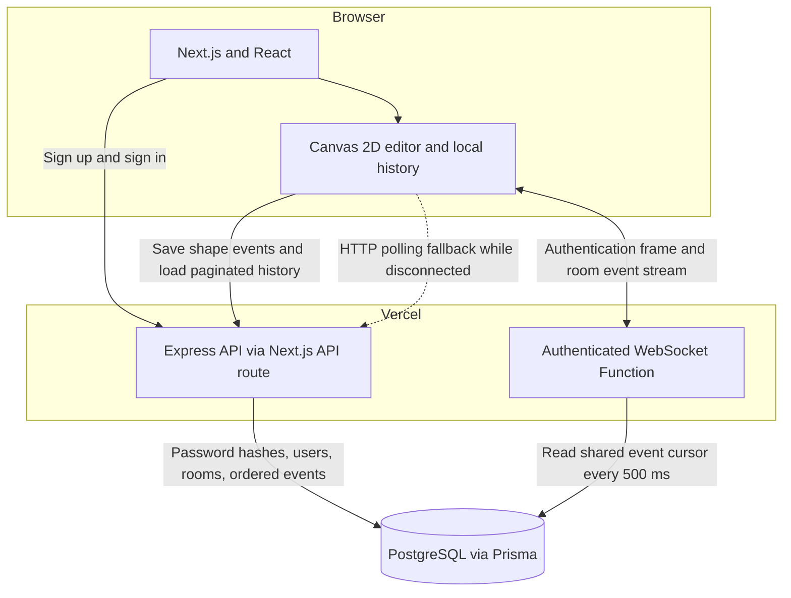

# Drawscape

A collaborative whiteboard for software architecture, workflows, and shared ideas, built with Next.js, TypeScript, HTML Canvas, WebSockets, and PostgreSQL.

[Open Drawscape](https://draw-scape-frontend.vercel.app)

## Features

- Draw rectangles, diamonds, ellipses, arrows, lines, freehand strokes, text, and images.
- Select, move, resize, erase, undo/redo, zoom, and pan with keyboard shortcuts.
- Share a room link with other signed-in users to collaborate.
- Save canvas changes to PostgreSQL and restore them after a refresh.
- Synchronize creation, movement, deletion, undo, and redo through persisted events.
- Reconnect automatically and use HTTP polling while the WebSocket connection is unavailable.
- Register and sign in with email/password. Google OAuth is optional when configured.
- Import PNG, JPEG, WebP, and GIF images up to 1.4 MB.

## Architecture



The frontend, API, and WebSocket endpoint share one origin on Vercel. The HTTP API persists changes before returning success. Each WebSocket connection reads the room's shared event log, so clients can receive changes even when they connect to different Function instances.

Events use an ordered cursor and per-room transaction locking. History is paginated and limited by response size so large scenes and images do not require one oversized response. Deletions are stored as tombstones; replaying the log reconstructs the current scene.

Local development also includes a standalone HTTP server on port 3001 and a WebSocket server on port 8080. Next.js serves its own API routes on port 3000.

## Stack

| Layer | Technologies |
| --- | --- |
| Client | Next.js 16, React 19, TypeScript 5.9, Canvas 2D, Tailwind CSS 4 |
| API | Express 5, Zod, Node.js crypto scrypt, JWT |
| Collaboration | WebSockets, shared PostgreSQL event log, reconnect and HTTP fallback |
| Database | PostgreSQL, Prisma 7, bounded pg connection pool |
| Workspace | Bun 1.4.2, Turborepo |
| Hosting | Vercel, Node.js 24 |

## Run locally

Use Node.js 24+, Bun 1.4.2, and a PostgreSQL database.

```bash
bun install
```

Copy `.env.example` to a root `.env` and set `DATABASE_URL` and a random `JWT_SECRET` of at least 32 characters. Secrets must never be committed. To generate a secret:

```bash
node -e "console.log(require('node:crypto').randomBytes(48).toString('hex'))"
```

Generate the database client and apply migrations:

```bash
bun run --filter @repo/db generate
cd packages/db
bunx prisma migrate deploy --config prisma7.config.ts
cd ../..
bun run dev
```

Open [localhost:3000](http://localhost:3000). Create an account with a password of at least 10 characters, open a canvas, and use Share to copy its room link.

## Environment

| Variable | Purpose |
| --- | --- |
| `DATABASE_URL` | PostgreSQL connection string |
| `JWT_SECRET` | Random secret with at least 32 characters; there is no fallback |
| `FRONTEND_URL` | Canonical app origin, used for CORS and OAuth redirects |
| `NEXT_PUBLIC_API_URL` | Optional separate API origin; leave empty for same origin |
| `NEXT_PUBLIC_WS_URL` | Optional WebSocket endpoint; deployment defaults to same-origin `/api/ws` |
| `GOOGLE_CLIENT_ID`, `GOOGLE_CLIENT_SECRET` | Optional Google OAuth credentials |
| `GOOGLE_REDIRECT_URI` | Must equal `FRONTEND_URL + /api/v1/auth/google/callback` and be registered in Google Cloud |

Google sign-in is shown only when the OAuth settings match. Email sign-in works independently.

## API

| Method | Route | Purpose |
| --- | --- | --- |
| GET | `/api/v1/health` | Verify application configuration and database connectivity |
| POST | `/api/v1/signup` | Create an account with a salted scrypt password hash |
| POST | `/api/v1/signin` | Verify credentials and issue a seven-day JWT |
| POST | `/api/v1/room` | Create or join a room using `roomName` |
| POST | `/api/v1/rooms/:slug/join` | Create or join a shared room |
| GET | `/api/v1/chats/:slug?after=0` | Read ordered events with `nextCursor` and `hasMore` |
| POST | `/api/v1/events/:slug` | Persist a shape update or deletion |
| GET | `/api/v1/room/:slug` | Read room metadata |
| GET | `/api/v1/auth/providers` | Read enabled sign-in providers |
| GET | `/api/v1/auth/google` | Start configured Google OAuth |
| GET | `/api/v1/auth/google/callback` | Validate OAuth state and complete sign-in |

Room, event, and history routes require an `Authorization: Bearer <token>` header. Rooms use link-based sharing: a signed-in user with the room URL can read and edit that room.

The WebSocket endpoint is `/api/ws`. Send `{type: "auth", token}` as the first frame, then `{type: "join_room", roomId, after}` after receiving `authenticated`. Tokens are not placed in WebSocket URLs.

## Verification

```bash
bun test tests/security.test.ts
bun run lint
bun run check-types
bun run build
```

For the integration checks, start the built frontend and local WebSocket server in separate terminals:

```bash
bun run --filter frontend start
bun run --cwd apps/ws-backend src/index.ts
```

Then run:

```bash
bun scripts/smoke-test.ts
```

The integration script verifies database health, hashed password storage, valid and invalid sign-in, duplicate-account handling, protected history, two-client WebSocket delivery, deletion, scene reconstruction, cursor reads, and malformed-input rejection. It creates disposable accounts and removes their data afterward. The same checks were run against the Vercel preview before production promotion.

## Deploy on Vercel

Use the repository root as the uploaded workspace and `apps/frontend` as the project's Root Directory. Select Next.js, Node.js 24, install with `bun install`, and build with `cd ../.. && bun run build`. Configure the environment variables in Vercel and apply database migrations before deploying.

Prisma Client is generated during every build for the deployment platform. WebSocket Functions have a bounded lifetime; the client reconnects and resumes from its last saved event cursor.

## Performance and scope

The previous raw localhost relay benchmarks apply to the earlier relay implementation. They are not performance claims for this persisted deployment. Current production latency, concurrent-user capacity, and browser frame-time benchmarks have not been established.

This version uses a 500 ms database polling interval for each active WebSocket connection and a 1.5-second HTTP fallback interval. A dedicated pub/sub service and event-log compaction would be appropriate before larger-scale usage. Collaboration is last-write-wins for individual elements; rooms do not have private invitations or editor roles. Undo/redo history is local to the current browser session.

Transport encryption is provided by HTTPS/WSS on deployment. This application does not implement end-to-end encryption.

## Resume bullets

- Built Drawscape, a collaborative architecture whiteboard using Next.js, React, TypeScript, and HTML Canvas, with drawing, selection, resizing, undo/redo, image import, zoom, and pan.
- Implemented authenticated APIs and WebSocket collaboration with salted password hashing, expiring JWTs, durable PostgreSQL events, cursor pagination, automatic reconnects, and HTTP fallback.
- Deployed the frontend, API, and WebSocket endpoint on Vercel and verified authentication, two-client event synchronization, deletion, and scene recovery through integration tests.

Use only bullets that describe work you personally completed. Add performance figures after measuring this deployed version under a documented workload.
